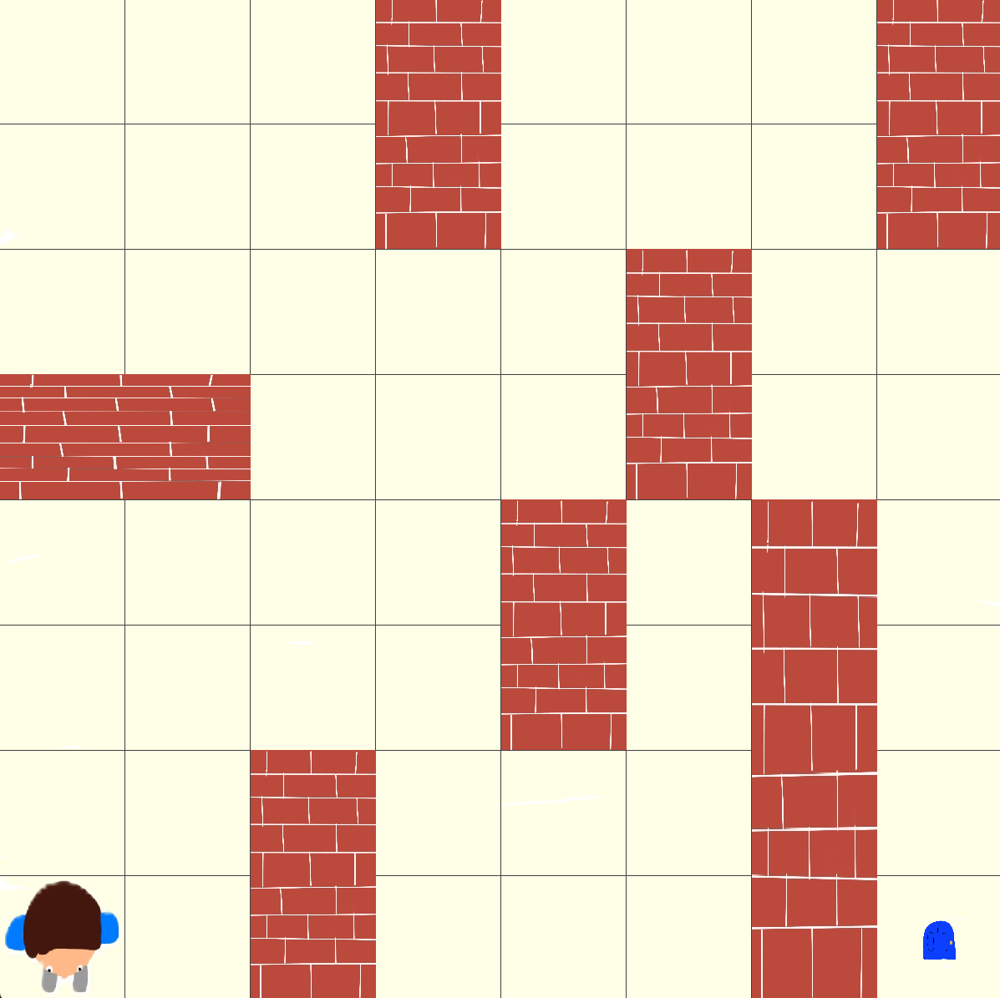

# First Game
### Made by Mouad Assal

## Project Presentation
This project is a 2D game with a simple objective: reach the door to get to the next level.

## Technologies used

- **Java** : Language used in the project.
- **LibGDX** : A Java framework used to develop the game.
- **Gradle** : Build automation tool used to compile and manage the project.

## Game

The game currently features one completed level. The objective is straightforward: use the arrow keys to reach the door while avoiding obstacles.

Once you reach the door, you can progress to the next level.

My goal is to give each level its own identity by introducing different gameplay mechanics, which I plan to explore further in the Future Improvements section.

## Screenshots

*This is how the first level starts.*

## How to run the game

Since the game is still in development, it is not currently available as a standalone download.

So for now the only way to play is to download this repository. After downloading, you should open the file in an IDE (IntelliJ IDEA is recommended) and run the Lwjgl3Launcher which you can find in this path : lwjgl3/src/main/java/io.github.firstGame.lwjgl3

## Futur Improvements

There's still a lot to be done! Here are some of the main features I plan to implement:

- **Finalizing the second level** : My plan is to introduce two monsters that roam around the level. To reach the next level, the player must get to the door without crossing their paths. Otherwise, the level must be restarted.
- **Third level** : This one will take place in complete darkness, with the player relying on a flashlight to see their surroundings.
- **Menu** : I plan on adding a menu to select between levels, pause the game, quit, and go to the main screen.
